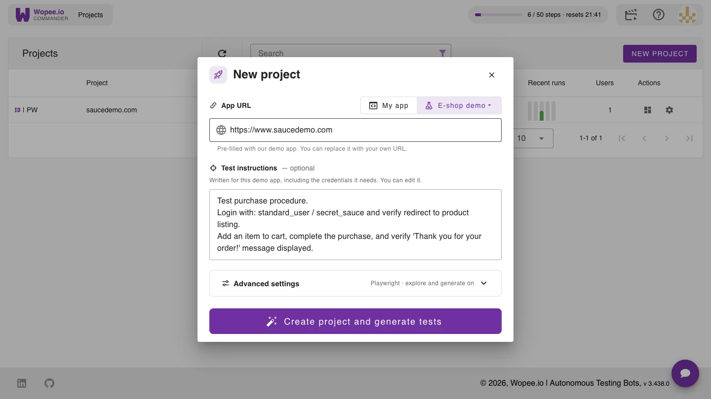
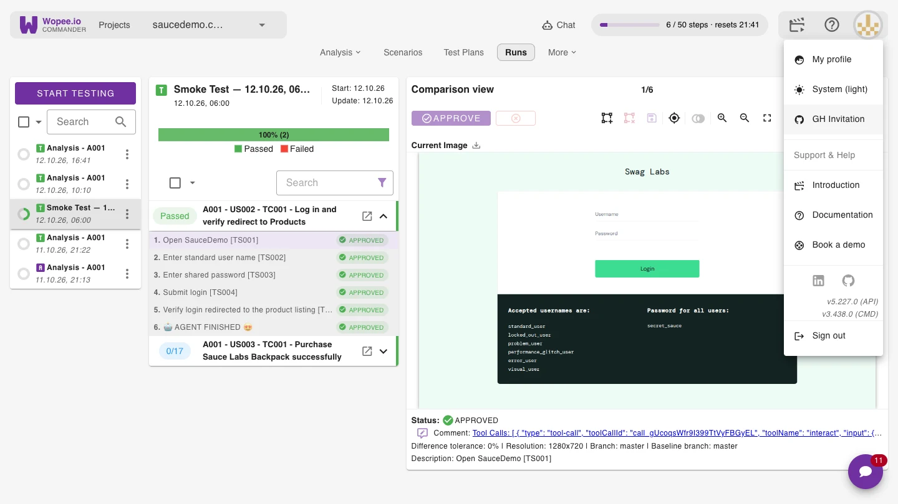
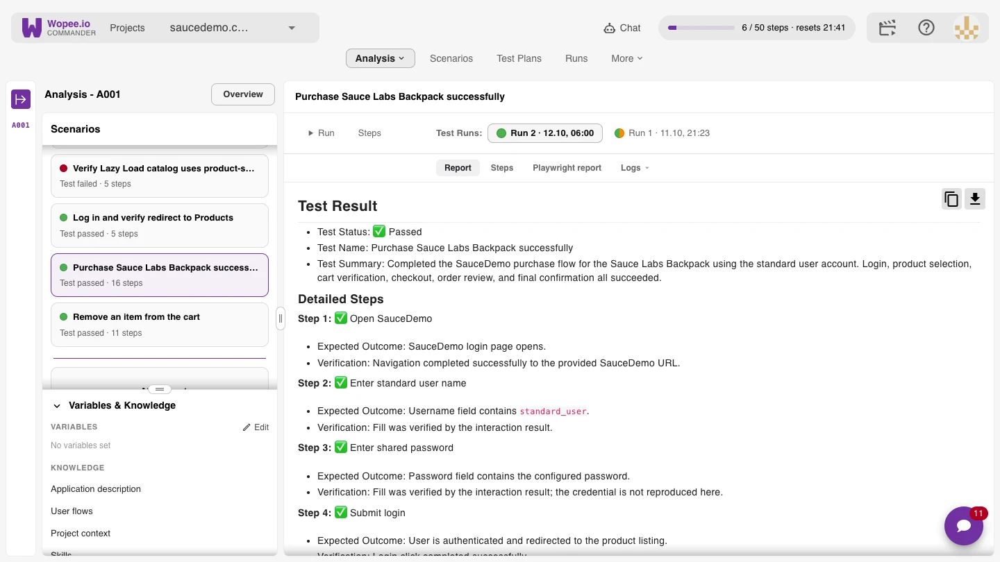
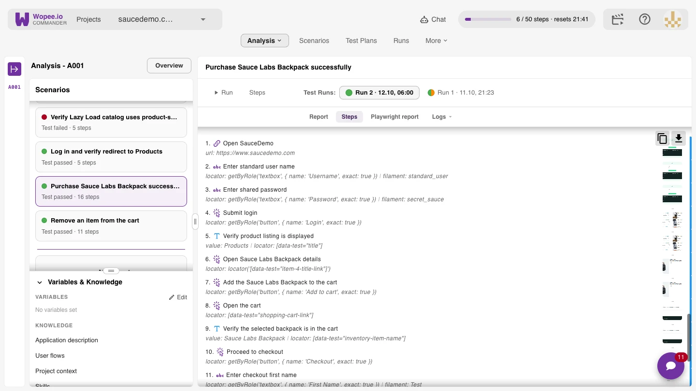
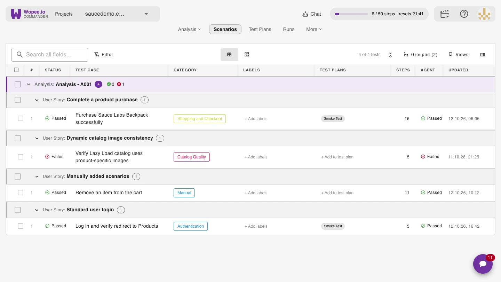
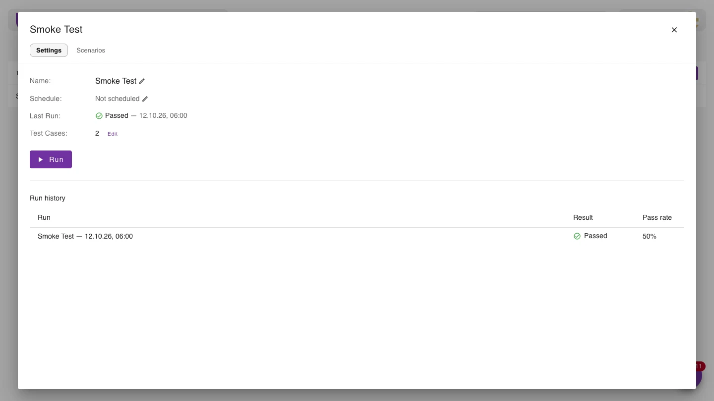
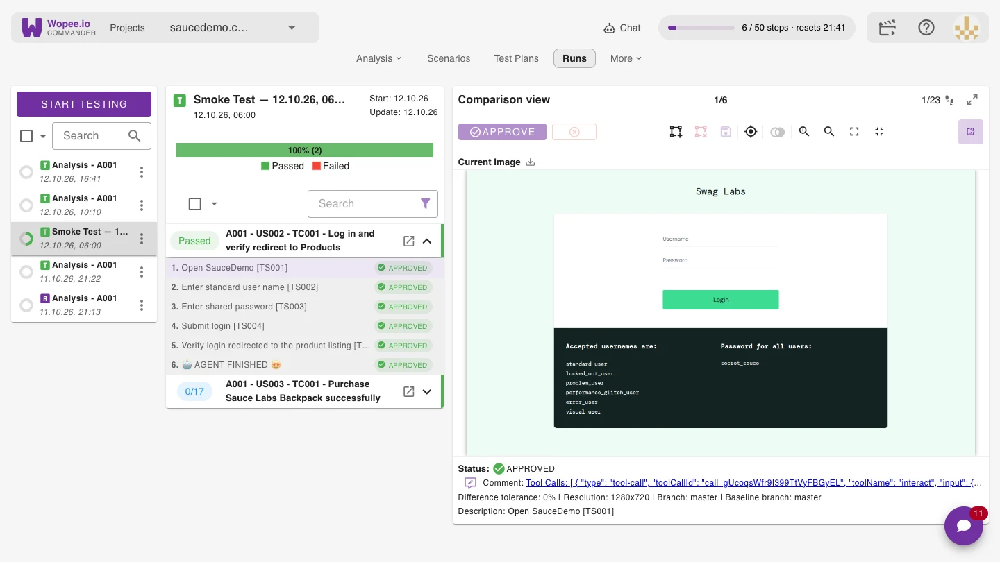

# 🤖 Getting started

Your first AI test, from a URL to a verdict, in a few minutes. Prefer to watch first? Here is the 6-minute quick start:

<iframe style="width: 100%; height: 100%; border: 0; display: block;" src="https://www.youtube.com/embed/o5ThjRddZfw" title="Wopee.io quick start: your first AI test in 6 minutes" allow="accelerometer; autoplay; clipboard-write; encrypted-media; gyroscope; picture-in-picture; web-share" referrerpolicy="strict-origin-when-cross-origin" allowfullscreen></iframe>

## 1. Sign in to [Wopee Commander](https://cmd.wopee.io)

1. Go to [https://cmd.wopee.io](https://cmd.wopee.io).
2. Sign in with your [GitHub](https://github.com/signup), [GitLab](https://gitlab.com/users/sign_up) or [Google](https://accounts.google.com/) account.

You land on the **Projects** page. Every app you test lives here as one project.

## 2. Create a project and start the first Analysis

1. Click **NEW PROJECT**.
2. Paste the URL of your app, or pick a demo (**E-shop demo**, **Website demo** or **Banking demo**). The demos come with test instructions already filled in.
3. Under **Test instructions**, describe in plain English what matters to you, including any test credentials. For example: _Log in with the test account, add an item to the cart, complete the purchase, and verify the "Thank you" message._ You can leave it empty and let the agent decide.
4. Click **Create project and generate tests**.

!!! tip "Advanced settings"

    The test framework (Playwright) is fixed once the project exists. Switch off **Explore the app and generate tests** to create an empty project and add your own tests first.

## 3. Accept the GitHub invitation

Every project gets its own GitHub repository. To open it, accept the invitation: open the menu under your avatar, click **GH Invitation**, and click **Join** on GitHub.

## 4. Watch the agent explore

The first Analysis starts right away. You see a live view of the agent's browser: it opens your app, logs in, clicks through the pages and checks what it sees. From what it saw, it writes:

- an **application description**,
- **user flows**, written as user stories,
- **test scenarios** for those flows, and runs every one of them, so you start with real results.

All of them are under **Variables & Knowledge** and in the scenario list. Edit any of them, or add instructions and regenerate.

## 5. Read the verdict

Click a scenario to open its run. The **Report** gives the verdict, every step with what was expected and what the agent verified, any issues it found, and a final analysis. When a test fails, read the report first: it tells you whether the app has a bug or the test needs a fix.

Under **Steps**, every step has its Playwright locator and a screenshot. When your page changes, the agent can pick a better locator, so the test [heals itself](concepts/self-healing.md). The **Playwright report** shows exactly what ran.

## 6. Your test library

**Scenarios** lists every test, grouped by Analysis and user story, with its category, number of steps and the agent's last verdict.

To write your own test, click **+ New test**, give it a name and describe it in plain English. On its first run the agent works out the steps; keep **Save steps from this run** switched on, and later runs replay them.

## 7. Test Plans and schedules

Group tests into a **Test Plan** (for example _Smoke Test_), run it by hand with **Run**, or put it on a schedule: every hour, day, week, month, or a custom cron expression.

## 8. Runs and visual checks

Every execution lands in **Runs**. Each step's screenshot is compared with its approved baseline, so you also see visual changes, not only broken clicks.

You can **👍 Approve** or **👎 Reject** the current state of the tested application if its [Test Step Status](glossary.md#test-step-status) is:

- `New` - no previous state was approved (for this test step)
- `Unresolved` - previous state was already approved but current state is different (for this test step)

## 9. Your tests in your repository

Each Analysis has its own branch in the project's GitHub repository: the user flows are a Markdown file, and the scenarios, with every step and Playwright locator, are a JSON file. Every change is a commit. Open the repository from **More** › **Repo**, or the whole project in VS Code or Cursor.

!!! note "Free plan and step limits"

    The free plan gives the agent 50 steps every 5 hours and 2 projects. Every paid plan starts with the first month on us: see **Upgrade** in the app.

## More

- [🛠️ Tools & Assertions](concepts/tools-and-assertions.md): how the agent interacts with your app
- [🩹 Self-Healing](concepts/self-healing.md): how tests keep working when your UI changes
- Integrate your existing tests: [Playwright](playwright-visual-testing.md), [Cypress](cypress/01-getting-started.md), [Robot Framework](robot-framework/01-getting-started.md), [WebdriverIO](webdriverio-visual-testing.md)
- Short videos: [Wopee.io in 2 minutes](https://youtu.be/X4vKIrlauik), [Visual checks](https://youtu.be/jLA-rA1AHd0), [Your tests, your repo](https://youtu.be/7yLnLJBpBB4)
